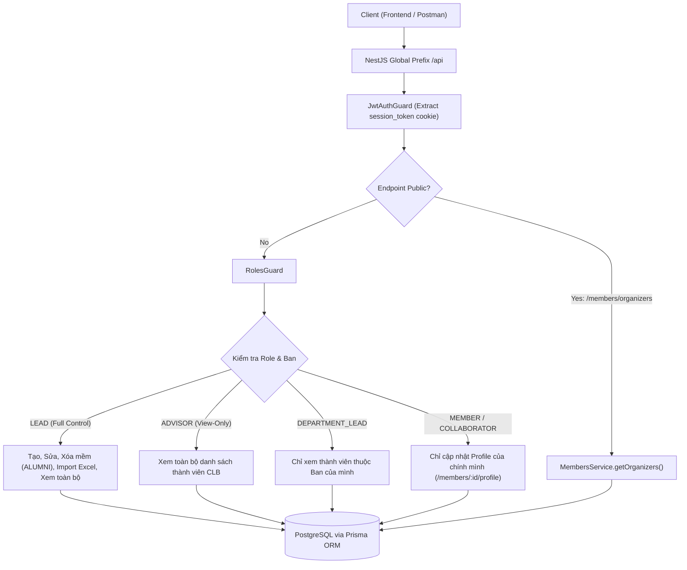

# 🚀 GDGoC Platform — Báo Cáo Hoàn Thành Sprint 02 (Walkthrough)
**Phân hệ:** Module HR & Quản lý Thành viên (Members & HR Management)  
**Thời gian hoàn thành:** 23/09/2026  
**Người thực hiện:** Web Lead + AI Co-Pilot  

---

## 1. 📁 Nhật Ký Thay Đổi Mã Nguồn (Changelog)

Toàn bộ các tệp mã nguồn mới và cập nhật trong Sprint 02:

| STT | Tập tin | Thao tác | Mô tả chức năng |
| :---: | :--- | :---: | :--- |
| 1 | `backend/src/modules/members/dto/query-members.dto.ts` | **NEW** | DTO truy vấn danh sách thành viên hỗ trợ filter `tenureId`, `departmentCode`, `status`, `search`, `page`, `limit`. |
| 2 | `backend/src/modules/members/dto/create-member.dto.ts` | **NEW** | DTO tạo thành viên mới với validation regex MSSV FPT, email FPT, enum ban và role. |
| 3 | `backend/src/modules/members/dto/update-member.dto.ts` | **NEW** | DTO BCN cập nhật vai trò, ban, trạng thái và chức danh hiển thị. |
| 4 | `backend/src/modules/members/dto/update-profile.dto.ts` | **NEW** | DTO thành viên tự chỉnh sửa bio, skills, avatarUrl và liên kết mạng xã hội (GitHub, LinkedIn, Facebook, Discord). |
| 5 | `backend/src/modules/members/dto/import-members.dto.ts` | **NEW** | DTO nhận metadata khi upload file Excel (`tenureId`, `defaultRole`, `departmentCode`). |
| 6 | `backend/src/modules/members/utils/excel-parser.util.ts` | **NEW** | Module bóc tách tệp Excel (`.xlsx` / `.csv`), chuẩn hóa tên cột tiếng Việt/Anh, validate dữ liệu từng dòng. |
| 7 | `backend/src/modules/members/members.service.ts` | **NEW** | Xử lý toàn bộ business logic cho 7 endpoints, hash mật khẩu `bcrypt`, bảo mật RBAC, soft delete. |
| 8 | `backend/src/modules/members/members.controller.ts` | **NEW** | Định nghĩa 7 API endpoints chuẩn RESTful, tích hợp `@UseGuards(JwtAuthGuard, RolesGuard)` và Swagger documentation. |
| 9 | `backend/src/modules/members/members.module.ts` | **NEW** | Module NestJS kết nối `PrismaModule` và export `MembersService`. |
| 10 | `backend/src/app.module.ts` | **MODIFY** | Đăng ký `MembersModule` vào AppModule root. |
| 11 | `backend/package.json` | **MODIFY** | Cài đặt `xlsx` và `@types/multer`. |

---

## 2. 🏛️ Kiến Trúc Hệ Thống & Luồng Nghiệp Vụ (Architecture & Business Logic Flow)

### 2.1. Sơ đồ Luồng Phân Quyền & Quản Lý Nhân Sự (RBAC Flow)

---

### 2.2. Chi tiết Luồng Xử Lý Nghiệp Vụ Từng Endpoint

#### 1️⃣ `GET /api/members` (Lọc đa tầng & Phân trang)
- **Xác thực**: `LEAD`, `ADVISOR`, `DEPARTMENT_LEAD`.
- **Logic**:
  - Nếu không truyền `tenureId`, hệ thống tự động tìm nhiệm kỳ đang active (`isFrozen: false`).
  - Nếu user là `DEPARTMENT_LEAD`, hệ thống tự động áp đặt điều kiện `departmentId = user.departmentId`, ngăn chặn việc xem dữ liệu ban khác.
  - Hỗ trợ tìm kiếm không phân biệt hoa thường (`mode: 'insensitive'`) trên cả 3 trường: `fullName`, `mssv`, `email`.
  - Phân trang chuẩn với `skip` và `take`, trả về `items`, `total`, `page`, `totalPages`.

#### 2️⃣ `POST /api/members` (BCN thêm thành viên lẻ)
- **Xác thực**: Chỉ `LEAD`.
- **Logic**:
  - Kiểm tra xem sinh viên đã có trong hệ thống `User` chưa (dựa theo `email` hoặc `mssv`).
  - Nếu chưa có: Tạo mới tài khoản với mật khẩu mặc định `GDGoC@${mssv}` (được hash bảo mật qua `bcrypt` Salt = 10).
  - Kiểm tra tính duy nhất trong nhiệm kỳ: Nếu thành viên đã tham gia kỳ này (`userId_tenureId` đã tồn tại), ném lỗi `409 Conflict`.
  - Tạo bản ghi `UserTenure` với trạng thái `ACTIVE` và ban được chỉ định.

#### 3️⃣ `PUT /api/members/:id` (BCN cập nhật chức danh, ban, vai trò)
- **Xác thực**: Chỉ `LEAD`.
- **Logic**: Hỗ trợ tìm `UserTenure` theo cả `id` của bản ghi hoặc `userId` trong kỳ active. Cập nhật linh hoạt `role`, `status`, `position` và chuyển đổi ban `departmentId`.

#### 4️⃣ `DELETE /api/members/:id` (Xóa mềm - Soft Delete)
- **Xác thực**: Chỉ `LEAD`.
- **Logic**: Không xóa vật lý dữ liệu (để bảo toàn lịch sử tasks, điểm danh và gems). Chuyển trạng thái `UserTenure.status` sang `ALUMNI`. Trả về `204 No Content`.

#### 5️⃣ `POST /api/members/import` (Bóc tách file Excel hàng loạt)
- **Xác thực**: Chỉ `LEAD`.
- **Bộ bóc tách (`parseMembersExcel`)**:
  - Tự động nhận diện linh hoạt tiêu đề các cột tiếng Việt/Anh: MSSV, Họ tên, Email, Số điện thoại, Ban, Vai trò, Chức danh.
  - Chuẩn hóa tên ban: Map tự động các từ khóa phổ biến (ví dụ: "AI", "Trí tuệ nhân tạo" ➔ `TECH_AI`; "Nhân sự", "Sự kiện" ➔ `HR_EVENT`).
  - Validate format MSSV, Email từng dòng.
  - Báo cáo kết quả dạng Envelope: `{ "added": number, "skipped": number, "errors": string[] }`.

#### 6️⃣ `PUT /api/members/:id/profile` (Tự cập nhật thông tin cá nhân)
- **Xác thực**: Mọi thành viên đã đăng nhập (kiểm tra quyền sở hữu `currentUser.id === id` hoặc role `LEAD`).
- **Logic**: Cập nhật thông tin cấp user (`avatarUrl`, `phoneNumber`, `githubUrl`, `linkedinUrl`, `facebookUrl`, `discordUsername`) và thông tin theo kỳ (`bio`, `skills`).

#### 7️⃣ `GET /api/members/organizers` (Public Organizers cho Landing Page)
- **Xác thực**: Public (Không cần cookie hay token).
- **Logic**: Lấy danh sách thành viên cốt cán (`role` thuộc `[LEAD, DEPARTMENT_LEAD, ADVISOR]` hoặc thuộc ban `EXECUTIVE`) của nhiệm kỳ hiện tại để hiển thị trên Landing Page.

---

## 3. 📚 Tài Liệu Tham Khảo Chính Thống (Official References)

1. **NestJS Authentication & Guards Guide**:
   - [NestJS Security - Authentication](https://docs.nestjs.com/security/authentication)
   - [NestJS Custom Route Decorators](https://docs.nestjs.com/custom-decorators)
2. **NestJS File Upload (Multer & Express)**:
   - [NestJS File Upload Techniques](https://docs.nestjs.com/techniques/file-upload)
3. **Prisma ORM Relations & Transactions**:
   - [Prisma Relations (1-to-n, m-to-n)](https://www.prisma.io/docs/concepts/components/prisma-schema/relations)
   - [Prisma Filtering & Sorting](https://www.prisma.io/docs/reference/api-reference/prisma-client-reference#filter-conditions-and-operators)
4. **OWASP Authentication & Sensitive Data Exposure Prevention**:
   - [OWASP Password Storage Cheat Sheet](https://cheatsheetseries.owasp.org/cheatsheets/Password_Storage_Cheat_Sheet.html)
   - [OWASP Access Control Cheat Sheet](https://cheatsheetseries.owasp.org/cheatsheets/Access_Control_Cheat_Sheet.html)
5. **SheetJS (XLSX) Community Edition**:
   - [SheetJS Docs - Reading Workbooks](https://docs.sheetjs.com/docs/api/parse-options)
