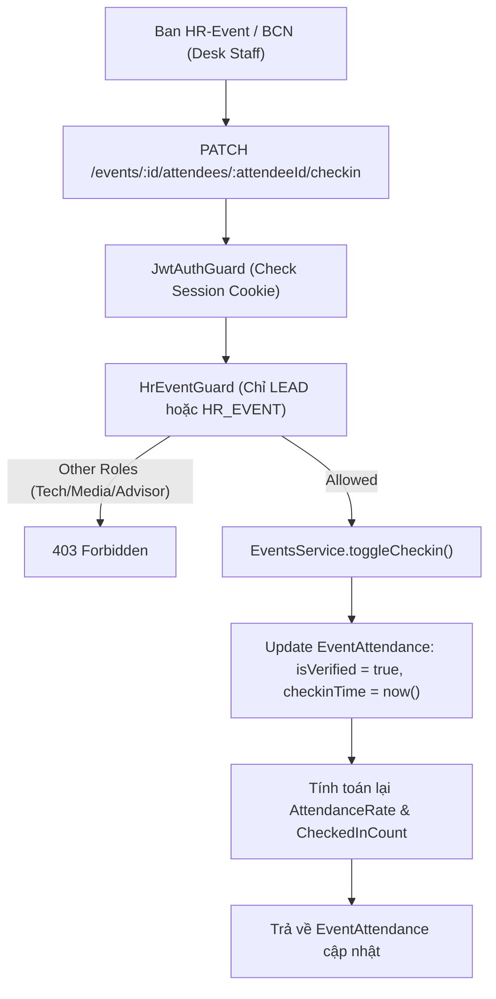

# 🚀 GDGoC Platform — Báo Cáo Hoàn Thành Sprint 03 (Walkthrough)
**Phân hệ:** Module Sự Kiện & Điểm Danh (Events & Attendance Engine)  
**Thời gian hoàn thành:** 23/09/2026  
**Người thực hiện:** Web Lead + AI Co-Pilot  

---

## 1. 📁 Nhật Ký Thay Đổi Mã Nguồn (Changelog)

Các tệp mã nguồn mới và cập nhật trong Sprint 03:

| STT | Tập tin | Thao tác | Mô tả chức năng |
| :---: | :--- | :---: | :--- |
| 1 | `backend/src/modules/events/dto/query-event.dto.ts` | **NEW** | DTO truy vấn sự kiện: `tenureId`, `isPublic`, `type`, `status`, `search`. |
| 2 | `backend/src/modules/events/dto/add-attendee.dto.ts` | **NEW** | DTO thêm người tham dự (thành viên hoặc khách ngoài) tại bàn sự kiện. |
| 3 | `backend/src/modules/events/dto/toggle-checkin.dto.ts` | **NEW** | DTO chuyển đổi trạng thái điểm danh kèm ảnh minh chứng và ghi chú. |
| 4 | `backend/src/modules/events/dto/create-event.dto.ts` | **MODIFY** | Bổ sung trường `bannerImageUrl`, `registrationUrl`, `isPublic`. |
| 5 | `backend/src/modules/events/guards/hr-event.guard.ts` | **NEW** | Guard bảo vệ phân quyền độc quyền cho `LEAD` và thành viên ban `HR_EVENT`. |
| 6 | `backend/src/modules/events/events.service.ts` | **MODIFY** | Xử lý nghiệp vụ sự kiện, thống kê `attendanceRate`, `attendeeCount`, check-in và settle gems. |
| 7 | `backend/src/modules/events/events.controller.ts` | **MODIFY** | Định nghĩa toàn bộ các REST endpoints điểm danh và sự kiện theo chuẩn API Contract v1.0. |

---

## 2. 🏛️ Kiến Trúc Hệ Thống & Luồng Nghiệp Vụ (Architecture & Flow)

### 2.1. Sơ đồ Luồng Điểm Danh & Phân Quyền Ban Sự Kiện (Attendance & Check-in Flow)

---

### 2.2. Chi tiết Nghiệp Vụ Từng Endpoint

#### 1️⃣ `GET /api/events` (Danh sách sự kiện & Thống kê)
- **Truy cập**: Public (cho Landing Page) hoặc Session Cookie.
- **Tính năng**:
  - Hỗ trợ lọc theo trạng thái: `upcoming` (`startTime > now`), `registration_open`, `completed` (`endTime < now`).
  - Tự động thống kê `attendeeCount` và `checkedInCount` cho từng sự kiện.

#### 2️⃣ `POST & PUT /api/events` (Quản lý Vòng đời Sự kiện)
- **Xác thực**: `LEAD` hoặc `DEPARTMENT_LEAD` của ban `HR_EVENT`.
- **Validation**: Kiểm tra tính hợp lệ của khoảng thời gian (`endTime > startTime`), kiểm tra tồn tại của `tenureId`.

#### 3️⃣ `GET /api/events/:id/attendees` (Danh sách Người Tham Dự & Tỷ lệ Điểm danh)
- **Xác thực**: Người dùng đã đăng nhập.
- **Dữ liệu trả về**: Mảng danh sách người tham gia kèm chỉ số `attendanceRate = Math.round((totalCheckedIn / totalRegistered) * 100)`.

#### 4️⃣ `POST /api/events/:id/attendees` (Check-in Tay Tại Bàn)
- **Xác thực**: `LEAD` và ban `HR_EVENT`.
- **Logic**: Hỗ trợ ghi nhận tham dự cho cả thành viên trong CLB (theo `userId`) hoặc khách mời/sinh viên ngoài trường (tự động tạo hồ sơ khách `guestUser`).

#### 5️⃣ `PATCH /api/events/:id/attendees/:attendeeId/checkin` (Toggle Điểm danh)
- **Phân quyền độc quyền**: `HrEventGuard` chỉ cấp phép cho `LEAD` và `HR_EVENT`.
- **Logic**: Cập nhật trạng thái `isVerified`, lưu vết người xác nhận `verifiedById` và thời gian điểm danh thực tế.

#### 6️⃣ `POST /api/events/:eventId/organizers/settle-gems` (Quyết toán Gems BTC)
- **Xác thực**: Chỉ `LEAD`.
- **Bảo mật**: Cơ chế `idempotencyKey = "event-organizer:${eventId}:${userId}"` chạy trong Prisma Database Transaction ngăn chặn tuyệt đối việc thưởng Gems trùng lặp khi bấm nút nhiều lần.

---

## 3. 📚 Tài Liệu Tham Khảo Chính Thống (Official References)

1. **NestJS Authorization & Role Guards**:
   - [NestJS RBAC & Authorization Documentation](https://docs.nestjs.com/security/authorization)
2. **Prisma Database Transactions (Interactive Transactions)**:
   - [Prisma Interactive Transactions Guide](https://www.prisma.io/docs/concepts/components/prisma-client/transactions#interactive-transactions)
3. **RESTful API Design for State Transitions**:
   - [RFC 5789 - PATCH Method for HTTP](https://datatracker.ietf.org/doc/html/rfc5789)
4. **OWASP Authorization Cheat Sheet**:
   - [OWASP Function-level Access Control](https://cheatsheetseries.owasp.org/cheatsheets/Access_Control_Cheat_Sheet.html)
