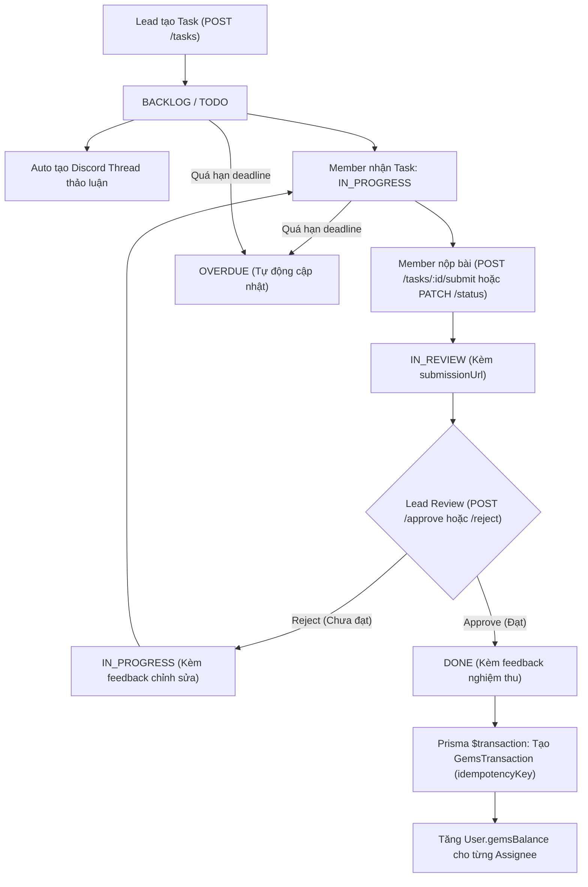

# 🚀 GDGoC Platform — Báo Cáo Hoàn Thành Sprint 04 (Walkthrough)
**Phân hệ:** Quản lý Công việc Kanban & Đồng bộ Workflow (Tasks Kanban & Workflow Sync)  
**Thời gian hoàn thành:** 23/09/2026  
**Người thực hiện:** Web Lead + AI Co-Pilot  

---

## 1. 📁 Nhật Ký Thay Đổi Mã Nguồn (Changelog)

Các tệp mã nguồn mới và cập nhật trong Sprint 04:

| STT | Tập tin | Thao tác | Mô tả chức năng |
| :---: | :--- | :---: | :--- |
| 1 | `backend/src/modules/tasks/dto/query-task.dto.ts` | **MODIFY** | Bổ sung bộ lọc `departmentCode` song song với `departmentId`, hỗ trợ phân trang & search. |
| 2 | `backend/src/modules/tasks/dto/create-task.dto.ts` | **MODIFY** | Hỗ trợ cả `departmentCode`/`departmentId` và `assigneeIds`/`assignees` (`TaskAssigneeInput`). |
| 3 | `backend/src/modules/tasks/dto/update-task-status.dto.ts` | **MODIFY** | Bổ sung `submissionUrl` và `feedback` khi chuyển trạng thái Kanban. |
| 4 | `backend/src/modules/tasks/dto/assign-task.dto.ts` | **MODIFY** | Hỗ trợ cả mảng User ID đơn giản (`assigneeIds`) và mảng phân vai trò (`assignees`). |
| 5 | `backend/src/modules/tasks/tasks.service.ts` | **MODIFY** | Xử lý nghiệp vụ Kanban, tự động quét `OVERDUE`, phân quyền cập nhật trạng thái, tự động cấp Gems ACID với `idempotencyKey` khi task `DONE`. |
| 6 | `backend/src/modules/tasks/tasks.controller.ts` | **MODIFY** | Bổ sung đầy đủ endpoints `PUT`, `PATCH`, `POST /submit`, `POST /approve`, `POST /reject`, `POST /assignees`, `DELETE` với `RolesGuard` RBAC. |

---

## 2. 🏛️ Kiến Trúc Hệ Thống & Luồng Nghiệp Vụ (Architecture & Flow)

### 2.1. Sơ đồ Vòng đời Task & Tự động Cấp Gems (Kanban Task Lifecycle & Gems Reward)

---

### 2.2. Chi tiết Nghiệp Vụ Từng Endpoint

#### 1️⃣ `GET /api/tasks` (Danh sách Tasks & Quét Overdue)
- **Truy cập**: Session Cookie (`JwtAuthGuard`).
- **Tính năng**:
  - Tự động phát hiện và chuyển các task có `deadline < now` và đang ở `TODO`/`IN_PROGRESS` sang trạng thái `OVERDUE`.
  - Hỗ trợ lọc theo `departmentCode` (ví dụ: `TECH_AI`), `departmentId`, `status`, `priority`, `assigneeId`, `tenureId`, `search`.
  - Trả về cấu trúc chứa cả `items` và `data` tương thích mọi màn hình Frontend.

#### 2️⃣ `POST /api/tasks` & `PUT /api/tasks/:id` (Quản lý Task & Phân quyền)
- **Xác thực**: `LEAD` hoặc `DEPARTMENT_LEAD` (với `RolesGuard`).
- **Linh hoạt**: Chấp nhận cả `departmentCode` (tự resolve `departmentId`) và `assigneeIds` dạng danh sách ID người dùng.
- **Discord Integration**: Tự động kích hoạt tạo Thread thảo luận trên channel của ban.

#### 3️⃣ `PATCH /api/tasks/:id/status` (Kéo thả Kanban & Bảo vệ Phân quyền)
- **Phân quyền**:
  - `MEMBER`: Chỉ được di chuyển trạng thái các task mà mình được gán làm assignee. Không được phép tự chuyển task sang `DONE`.
  - `LEAD` & `DEPARTMENT_LEAD`: Toàn quyền di chuyển trạng thái.
- **Tự động Cấp Gems**: Khi trạng thái chuyển sang `DONE`, hệ thống tự động gọi hàm cấp Gems an toàn cho toàn bộ assignees.

#### 4️⃣ `POST /api/tasks/:id/submit` (Nộp bài Nghiệm thu)
- **Truy cập**: Assignee, `LEAD`, hoặc `DEPARTMENT_LEAD`.
- **Logic**: Lưu link nộp bài (`submissionUrl`) và tự động chuyển trạng thái task sang `IN_REVIEW`.

#### 5️⃣ `POST /api/tasks/:id/approve` & `POST /api/tasks/:id/reject` (Duyệt/Từ chối Task)
- **Xác thực**: `LEAD` và `DEPARTMENT_LEAD`.
- **Logic Duyệt (`approve`)**:
  - Chuyển `status -> DONE`, lưu `feedback`.
  - Thực thi giao dịch ACID với `idempotencyKey = "task_reward_${taskId}_${assigneeUserId}"` để cộng `gemsReward` vào `gemsBalance`. Chống trùng lặp 100%.
- **Logic Từ chối (`reject`)**:
  - Chuyển `status -> IN_PROGRESS`, lưu `feedback` để thành viên biết nội dung cần chỉnh sửa và nộp lại.

#### 6️⃣ `DELETE /api/tasks/:id` (Xóa Task)
- **Xác thực**: Độc quyền dành cho `LEAD`.
- **Cascade**: Tự động dọn dẹp các bản ghi liên kết `TaskAssignee`.

---

## 3. 📚 Tài Liệu Tham Khảo Chính Thống (Official References)

1. **State Machine & Transition Validation in REST APIs**:
   - [RESTful State Pattern Best Practices](https://martinfowler.com/articles/richardsonMaturityModel.html)
2. **Idempotency in Financial / Gamification Ledgers**:
   - [Stripe API Idempotency Implementation Pattern](https://stripe.com/docs/api/idempotent_requests)
3. **Prisma Nested Writes & Transactions**:
   - [Prisma Nested Relations and Transaction Guides](https://www.prisma.io/docs/concepts/components/prisma-client/relation-queries)
4. **Discord Webhooks & Threads API**:
   - [Discord Developer Portal — Threads Resource](https://discord.com/developers/docs/resources/channel#start-thread-with-message)
