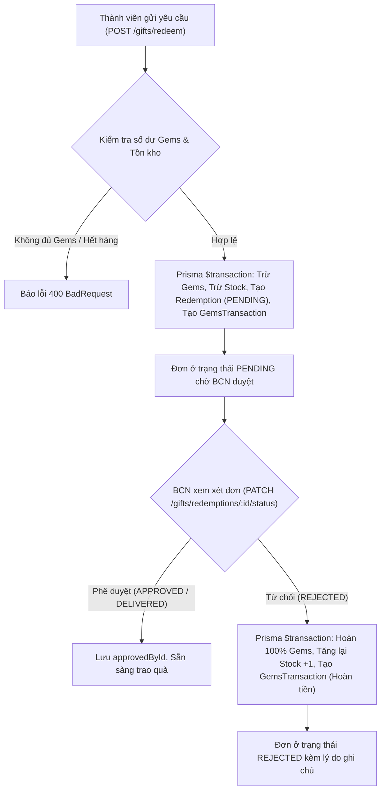

# 🚀 GDGoC Platform — Báo Cáo Hoàn Thành Sprint 05 (Walkthrough)
**Phân hệ:** Sổ Cái Giao Dịch Gems & Cửa Hàng Quà Tặng (Gems Ledger & Gift Shop)  
**Thời gian hoàn thành:** 23/09/2026  
**Người thực hiện:** Web Lead + AI Co-Pilot  

---

## 1. 📁 Nhật Ký Thay Đổi Mã Nguồn (Changelog)

Các tệp mã nguồn mới và cập nhật trong Sprint 05:

| STT | Tập tin | Thao tác | Mô tả chức năng |
| :---: | :--- | :---: | :--- |
| 1 | `backend/src/modules/gems/dto/query-leaderboard.dto.ts` | **NEW** | DTO truy vấn bảng xếp hạng Gems lọc theo `tenureId`, `departmentCode`, `limit`. |
| 2 | `backend/src/modules/gems/dto/query-transactions.dto.ts` | **NEW** | DTO xem lịch sử giao dịch sổ cái Gems (cá nhân hoặc BCN xem thành viên). |
| 3 | `backend/src/modules/gems/dto/adjust-gems.dto.ts` | **NEW** | DTO BCN điều chỉnh Gems thủ công (+ / -) kèm lý do. |
| 4 | `backend/src/modules/gems/gems.service.ts` | **NEW** | Xử lý logic tính bảng xếp hạng, delta tăng trưởng 7 ngày gần nhất, sổ cái giao dịch và điều chỉnh Gems. |
| 5 | `backend/src/modules/gems/gems.controller.ts` | **NEW** | Định nghĩa 3 REST endpoints: `GET /gems/leaderboard`, `GET /gems/transactions`, `POST /gems/adjust`. |
| 6 | `backend/src/modules/gems/gems.module.ts` | **NEW** | Module NestJS kết nối Prisma & Auth cho hệ thống Gems. |
| 7 | `backend/src/modules/gifts/dto/create-gift.dto.ts` | **NEW** | DTO BCN thêm quà tặng mới (`name`, `description`, `imageUrl`, `gemsPrice`, `stock`, `isActive`). |
| 8 | `backend/src/modules/gifts/dto/update-gift.dto.ts` | **NEW** | DTO cập nhật thông tin quà tặng. |
| 9 | `backend/src/modules/gifts/dto/redeem-gift.dto.ts` | **NEW** | DTO gửi yêu cầu đổi quà lưu niệm. |
| 10 | `backend/src/modules/gifts/dto/query-redemptions.dto.ts` | **NEW** | DTO lọc danh sách đơn đổi quà theo trạng thái và phân trang. |
| 11 | `backend/src/modules/gifts/dto/update-redemption-status.dto.ts` | **NEW** | DTO BCN duyệt (`APPROVED`, `DELIVERED`) hoặc từ chối (`REJECTED`) đơn đổi quà. |
| 12 | `backend/src/modules/gifts/gifts.service.ts` | **NEW** | Quản lý kho quà tặng, quy trình trừ Gems & tồn kho nguyên tử, tự động hoàn Gems/kho khi bị từ chối. |
| 13 | `backend/src/modules/gifts/gifts.controller.ts` | **NEW** | Định nghĩa các REST endpoints CRUD quà tặng, đổi quà và quản lý đơn. |
| 14 | `backend/src/modules/gifts/gifts.module.ts` | **NEW** | Module NestJS kết nối Prisma & Auth cho Gift Shop. |
| 15 | `backend/src/app.module.ts` | **MODIFY** | Đăng ký `GemsModule` và `GiftsModule` vào root application. |

---

## 2. 🏛️ Kiến Trúc Hệ Thống & Luồng Nghiệp Vụ (Architecture & Flow)

### 2.1. Sơ đồ Luồng Đổi Quà & Hoàn Gems khi Từ Chối (Gift Redemption & Refund Flow)

---

### 2.2. Chi tiết Nghiệp Vụ Từng Endpoint

#### 1️⃣ `GET /api/gems/leaderboard` (Bảng Xếp Hạng & Delta Tăng Trưởng)
- **Truy cập**: Session Cookie (`JwtAuthGuard`).
- **Tính năng**:
  - Sắp xếp các thành viên theo `gemsBalance DESC` trong nhiệm kỳ hoạt động.
  - Hỗ trợ lọc theo từng ban (`departmentCode`).
  - Tự động thống kê `delta` từ các giao dịch cộng Gems trong 7 ngày gần nhất (`+X tuần này`).
  - Trả về cờ `isFrozen` để Frontend hiển thị trạng thái đóng băng bảng xếp hạng khi hết kỳ.

#### 2️⃣ `GET /api/gems/transactions` (Lịch Sử Sổ Cái)
- **Truy cập**: Session Cookie.
- **Phân quyền**: Thành viên xem lịch sử của chính mình; BCN (`LEAD`) có thể xem lịch sử của bất kỳ thành viên nào thông qua query `userId`.

#### 3️⃣ `POST /api/gems/adjust` (Điều Chỉnh Thủ Công)
- **Xác thực**: Độc quyền `LEAD`.
- **An toàn**: Chặn trường hợp phạt âm quá số dư hiện có (`user.gemsBalance + amount < 0`).
- **Sổ cái**: Tạo bản ghi `GemsTransaction` với `idempotencyKey` duy nhất và cập nhật `gemsBalance`.

#### 4️⃣ `GET & POST & PUT & DELETE /api/gifts` (Quản Lý Kho Quà Tặng)
- **Xác thực**: `GET` cho mọi thành viên; `POST`, `PUT`, `DELETE` độc quyền dành cho `LEAD`.
- **Thông tin**: `name`, `description`, `imageUrl`, `gemsPrice`, `stock`, `isActive`.

#### 5️⃣ `POST /api/gifts/redeem` (Đổi Quà Nguyên Tử)
- **Xác thực**: Session Cookie.
- **Logic**: Kiểm tra tồn kho `stock > 0`, `isActive === true`, và số dư `gemsBalance >= gemsPrice`. Thực thi nguyên tử trong `$transaction`.

#### 6️⃣ `PATCH /api/gifts/redemptions/:id/status` (Duyệt Đơn & Cơ Chế Hoàn Gems)
- **Xác thực**: Độc quyền `LEAD`.
- **Hoàn trả tự động**: Nếu Lead chọn `REJECTED`, hệ thống tự động hoàn lại số Gems đã trừ cho thành viên và tăng lại số lượng tồn kho `stock` cho món quà.

---

## 3. 📚 Tài Liệu Tham Khảo Chính Thống (Official References)

1. **ACID Transactions & Atomicity in Financial Systems**:
   - [Database Transaction Isolation Levels & ACID Properties](https://www.postgresql.org/docs/current/transaction-iso.html)
2. **Prisma Interactive Transactions**:
   - [Prisma Interactive Transactions Reference](https://www.prisma.io/docs/concepts/components/prisma-client/transactions#interactive-transactions)
3. **Idempotency Keys in Payment & Points Processing**:
   - [Stripe Architecture for Idempotent Requests](https://stripe.com/docs/api/idempotent_requests)
4. **Gamification Leaderboards Optimization**:
   - [PostgreSQL Indexing for High-Performance Leaderboards](https://www.postgresql.org/docs/current/indexes-types.html)
