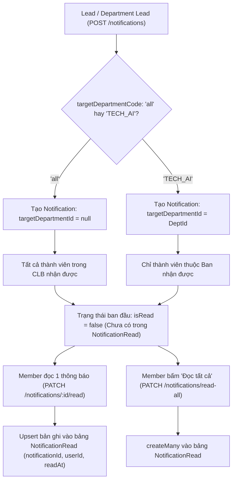

# 🚀 GDGoC Platform — Báo Cáo Hoàn Thành Sprint 06 (Walkthrough)
**Phân hệ:** Quản lý Kho Vật Tư & Trung Tâm Thông Báo (Inventory & Notifications Hub)  
**Thời gian hoàn thành:** 23/09/2026  
**Người thực hiện:** Web Lead + AI Co-Pilot  

---

## 1. 📁 Nhật Ký Thay Đổi Mã Nguồn (Changelog)

Các tệp mã nguồn mới và cập nhật trong Sprint 06:

| STT | Tập tin | Thao tác | Mô tả chức năng |
| :---: | :--- | :---: | :--- |
| 1 | `backend/src/modules/inventory/dto/create-inventory-item.dto.ts` | **NEW** | DTO thêm mới tài sản / vật tư (`name`, `category`, `quantity`, `holderName`, `holderUserId`, `notes`). |
| 2 | `backend/src/modules/inventory/dto/update-inventory-item.dto.ts` | **NEW** | DTO cập nhật thông tin vật tư. |
| 3 | `backend/src/modules/inventory/dto/query-inventory.dto.ts` | **NEW** | DTO tìm kiếm và lọc danh mục kho theo phân loại và phân trang. |
| 4 | `backend/src/modules/inventory/guards/inventory.guard.ts` | **NEW** | Custom Guard bảo vệ kho: `GET` cho `LEAD`, `ADVISOR`, `HR_EVENT`; `POST/PUT` cho `LEAD`, `HR_EVENT Lead`; `DELETE` chỉ `LEAD`. |
| 5 | `backend/src/modules/inventory/inventory.service.ts` | **NEW** | Xử lý nghiệp vụ CRUD vật tư, tìm kiếm đa trường và kiểm kê. |
| 6 | `backend/src/modules/inventory/inventory.controller.ts` | **NEW** | Định nghĩa 5 REST endpoints quản lý kho theo chuẩn API Contract. |
| 7 | `backend/src/modules/inventory/inventory.module.ts` | **NEW** | Module NestJS kết nối Prisma & Auth cho Inventory. |
| 8 | `backend/src/modules/notifications/dto/create-notification.dto.ts` | **NEW** | DTO phát thông báo (`title`, `message`, `type`, `priority`, `targetDepartmentCode`, `link`). |
| 9 | `backend/src/modules/notifications/dto/query-notifications.dto.ts` | **NEW** | DTO lọc thông báo theo type, unreadOnly và phân trang. |
| 10 | `backend/src/modules/notifications/notifications.service.ts` | **NEW** | Phân phối thông báo (Broadcast / Ban), tính `unreadCount`, đánh dấu đã đọc (`read`, `read-all`) và xóa thông báo. |
| 11 | `backend/src/modules/notifications/notifications.controller.ts` | **NEW** | Định nghĩa 5 REST endpoints trung tâm thông báo. |
| 12 | `backend/src/modules/notifications/notifications.module.ts` | **NEW** | Module NestJS kết nối Prisma & Auth cho Notifications. |
| 13 | `backend/src/app.module.ts` | **MODIFY** | Đăng ký `InventoryModule` và `NotificationsModule` vào root application. |

---

## 2. 🏛️ Kiến Trúc Hệ Thống & Luồng Nghiệp Vụ (Architecture & Flow)

### 2.1. Sơ đồ Luồng Phân Phối & Đánh Dấu Đọc Thông Báo (Notifications Delivery Flow)

---

### 2.2. Chi tiết Nghiệp Vụ Từng Endpoint

#### 1️⃣ `GET /api/inventory` (Danh Sách Vật Tư & Lọc Đa Tầng)
- **Xác thực**: `InventoryGuard` cho phép `LEAD`, `ADVISOR` (view-only), và toàn bộ thành viên ban `HR_EVENT`.
- **Tính năng**: Lọc theo phân loại `category` (Asset, Gift, Consumable), tìm kiếm `search` theo tên hoặc người nắm giữ, phân trang.

#### 2️⃣ `POST & PUT & DELETE /api/inventory` (Quản Lý Kho Vật Tư)
- **Phân quyền**:
  - `POST & PUT`: `LEAD` và `DEPARTMENT_LEAD` của ban `HR_EVENT`.
  - `DELETE`: Độc quyền dành cho `LEAD`.
- **Dữ liệu**: Ghi nhận số lượng `quantity`, người giữ `holderName` (hoặc "Kho CLB"), `holderUserId`, `notes`.

#### 3️⃣ `GET /api/notifications` (Trung Tâm Thông Báo Cá Nhân Hóa)
- **Truy cập**: Mọi thành viên đã đăng nhập (`JwtAuthGuard`).
- **Logic**:
  - Tự động lọc thông báo Broadcast (`targetDepartmentId === null`) và thông báo thuộc các ban mà user tham gia.
  - Đếm tổng số thông báo chưa đọc `unreadCount`.
  - Trả về danh sách kèm thuộc tính `isRead: true/false`.

#### 4️⃣ `POST /api/notifications` (Phát Thông Báo Mới)
- **Phân quyền**:
  - `LEAD`: Phát thông báo Broadcast toàn CLB (`targetDepartmentCode: "all"`) hoặc gửi riêng cho ban bất kỳ.
  - `DEPARTMENT_LEAD`: Chỉ được gửi thông báo cho chính ban chuyên môn của mình.

#### 5️⃣ `PATCH /api/notifications/:id/read` & `PATCH /api/notifications/read-all`
- **Logic Đọc một cái**: Sử dụng `upsert` vào bảng pivot `NotificationRead` để tránh duplicate lỗi unique key.
- **Logic Đọc tất cả**: Tìm toàn bộ thông báo chưa đọc của user và ghi nhận hàng loạt `createMany` với `skipDuplicates: true`.

#### 6️⃣ `DELETE /api/notifications/:id`
- **Phân quyền**: Chỉ BCN (`LEAD`) hoặc người tạo thông báo (`senderId === user.id`) mới có quyền xóa.

---

## 3. 📚 Tài Liệu Tham Khảo Chính Thống (Official References)

1. **Role-Based Access Control Pattern with Custom Guards in NestJS**:
   - [NestJS Custom Guards Documentation](https://docs.nestjs.com/guards)
2. **Notification Delivery & Multi-Tenant Partitioning Architecture**:
   - [Notification System Design Patterns](https://martinfowler.com/articles/patterns-of-distributed-systems/)
3. **Prisma Many-to-Many Pivot Relations & Upserting**:
   - [Prisma Relations & Upsert Reference](https://www.prisma.io/docs/concepts/components/prisma-client/relation-queries)
