# 🚀 GDGoC Platform — Báo Cáo Hoàn Thành Sprint 07 (Walkthrough)
**Phân hệ:** Cấu Hình Niên Khóa, Quản Trị Drive Assets & Landing CMS (Generation Config, Drive & CMS)  
**Thời gian hoàn thành:** 23/09/2026  
**Người thực hiện:** Web Lead + AI Co-Pilot  

---

## 1. 📁 Nhật Ký Thay Đổi Mã Nguồn (Changelog)

Các tệp mã nguồn mới và cập nhật trong Sprint 07:

| STT | Tập tin | Thao tác | Mô tả chức năng |
| :---: | :--- | :---: | :--- |
| 1 | `backend/src/modules/tenures/dto/update-tenure-config.dto.ts` | **NEW** | DTO cập nhật cấu hình nhiệm kỳ (`isFrozen`, `allowTaskSubmission`, `freezeLeaderboard`, `chapterLead`). |
| 2 | `backend/src/modules/tenures/dto/transition-tenure.dto.ts` | **NEW** | DTO chuyển giao nhiệm kỳ (`newTenureName`, `newGenLabel`, `startDate`, `endDate`, `carryOverCoreTeam`, `notifyAllMembers`). |
| 3 | `backend/src/modules/tenures/tenures.service.ts` | **MODIFY** | Xử lý cấu hình kỳ hiện tại, snapshot số liệu các kỳ cũ và Hero Feature chuyển giao kỳ trong database transaction. |
| 4 | `backend/src/modules/tenures/tenures.controller.ts` | **MODIFY** | REST endpoints: `GET /config/generation`, `PUT /config/generation`, `POST /config/generation/transition`. |
| 5 | `backend/src/modules/drive/dto/create-asset.dto.ts` | **NEW** | DTO đăng ký tài nguyên Google Drive (`name`, `category`, `driveUrl`, `driveFileId`, `accessLevel`, `departmentCode`, `tenureId`). |
| 6 | `backend/src/modules/drive/dto/update-asset.dto.ts` | **NEW** | DTO cập nhật tài nguyên Drive. |
| 7 | `backend/src/modules/drive/dto/query-assets.dto.ts` | **NEW** | DTO lọc tài nguyên theo 6 danh mục, 4 cấp độ quyền xem, ban và tìm kiếm. |
| 8 | `backend/src/modules/drive/drive.service.ts` | **MODIFY** | Xử lý CRUD tài nguyên và bộ lọc phân quyền ma trận 4 cấp độ. |
| 9 | `backend/src/modules/drive/drive.controller.ts` | **MODIFY** | REST endpoints: `GET`, `POST`, `PUT`, `PATCH`, `DELETE /assets` và `POST /drive/create-folder`. |
| 10 | `backend/src/modules/cms/dto/update-stats.dto.ts` | **NEW** | DTO cập nhật các thẻ thống kê tác động milestone trên Landing Page. |
| 11 | `backend/src/modules/cms/cms.service.ts` | **NEW** | Tính toán số liệu thống kê tác động realtime từ DB (Events, Attendees, Members, Tasks). |
| 12 | `backend/src/modules/cms/cms.controller.ts` | **NEW** | Public REST endpoints: `GET /cms/stats`, `PUT /cms/stats`, `GET /cms/events`. |
| 13 | `backend/src/modules/cms/cms.module.ts` | **NEW** | Module NestJS kết nối Prisma cho CMS. |
| 14 | `backend/src/app.module.ts` | **MODIFY** | Đăng ký `CmsModule` vào root application. |

---

## 2. 🏛️ Kiến Trúc Hệ Thống & Luồng Nghiệp Vụ (Architecture & Flow)

### 2.1. Sơ đồ Luồng Chuyển Giao Nhiệm Kỳ (Tenure Transition Workflow)

```mermaid
flowchart TD
    Lead["Ban Chủ Nhiệm (POST /config/generation/transition)"] --> Tx["Bắt đầu Prisma $transaction"]
    
    Tx --> Archive["1. Đóng băng & Lưu trữ kỳ cũ: isFrozen = true, isArchived = true"]
    Tx --> Snapshot["2. Thống kê Snapshot kỳ cũ: Tổng Tasks, Tổng Gems đã duyệt, Members, Events"]
    Tx --> CreateNew["3. Khởi tạo Nhiệm kỳ mới (Tên, Gen, Ngày bắt đầu - kết thúc)"]
    
    CreateNew --> CarryCheck{"carryOverCoreTeam: true?"}
    CarryCheck -- Có --> CopyCore["4. Sao chép Lead, Department Lead & Advisor sang kỳ mới"]
    CarryCheck -- Không --> NotifyCheck
    
    CopyCore --> NotifyCheck{"notifyAllMembers: true?"}
    NotifyCheck -- Có --> Broadcast["5. Tạo Notification URGENT Broadcast toàn CLB"]
    NotifyCheck -- Không --> Commit["Commit Transaction & Trả kết quả"]
    
    Broadcast --> Commit
```

---

### 2.2. Chi tiết Nghiệp Vụ Từng Endpoint

#### 1️⃣ `GET /api/config/generation` (Cấu Hình Kỳ Hiện Tại & Snapshot Lưu Trữ)
- **Truy cập**: Session Cookie (`JwtAuthGuard`).
- **Dữ liệu trả về**:
  - `currentTenure`: Thông tin nhiệm kỳ active (`name`, `genLabel`, `startDate`, `endDate`, `isFrozen`, `chapterLead`).
  - `allowTaskSubmission`, `allowRsvp`, `freezeLeaderboard`.
  - `archivedTenures`: Mảng các kỳ cũ kèm snapshot số liệu (`totalTasks`, `totalGems`, `membersCount`, `eventsCount`, `archivedAt`).

#### 2️⃣ `POST /api/config/generation/transition` (Chuyển Giao Nhiệm Kỳ Mới)
- **Xác thực**: Độc quyền `LEAD`.
- **Toàn vẹn**: Thực thi toàn bộ trong một Database Transaction, đảm bảo việc chuyển giao an toàn, không gián đoạn hệ thống.

#### 3️⃣ `GET /api/assets` (Ma Trận Phân Quyền Tài Nguyên Drive)
- **Ma trận 4 cấp độ**:
  - `PUBLIC`: Mọi người dùng.
  - `INTERNAL_MEMBER`: Tất cả thành viên CLB đã đăng nhập.
  - `DEPARTMENT_ONLY`: Chỉ thành viên cùng ban chuyên môn.
  - `EXECUTIVE_ONLY`: Độc quyền Ban Chủ Nhiệm (`LEAD`).
- **6 Danh mục**: `BRAND_KIT`, `TECH_LIBRARY`, `MEDIA_VAULT`, `PR_COMMS`, `FINANCE`, `HANDOVER_VAULT`.

#### 4️⃣ `GET /api/cms/stats` & `GET /api/cms/events` (Landing Page CMS)
- **Truy cập**: Công khai (Public - không cần login).
- **Tính năng**: Thống kê tự động realtime từ Database cho 4 chỉ số tác động lớn của CLB hoặc trả về số liệu tuỳ chỉnh do BCN cập nhật.

---

## 3. 📚 Tài Liệu Tham Khảo Chính Thống (Official References)

1. **Database Schema Evolution & Multi-Tenure Archiving Strategy**:
   - [Temporal Table & Historical Data Retention Patterns](https://www.postgresql.org/docs/current/rangetypes.html)
2. **NestJS Role-Based Matrix Permission Filters**:
   - [NestJS Authorization Guards Documentation](https://docs.nestjs.com/security/authorization)
3. **Public Cache & CMS Optimization for High-Traffic Landing Pages**:
   - [NestJS In-Memory Cache & Interceptors](https://docs.nestjs.com/techniques/caching)
