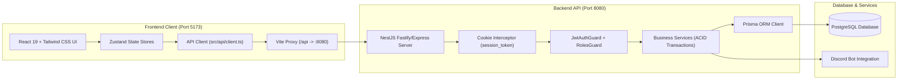

# 🚀 GDGoC Platform — Báo Cáo Hoàn Thành Sprint 08 (Walkthrough)
**Phân hệ:** Tích Hợp Hệ Thống & Kiểm Thử Toàn Diện (Integration & End-to-End Test)  
**Thời gian hoàn thành:** 23/09/2026  
**Người thực hiện:** Web Lead + AI Co-Pilot  

---

## 1. 📁 Nhật Ký Thay Đổi Mã Nguồn (Changelog)

Các tệp mã nguồn mới và cập nhật trong Sprint 08:

| STT | Tập tin | Thao tác | Mô tả chức năng |
| :---: | :--- | :---: | :--- |
| 1 | `frontend/vite.config.ts` | **MODIFY** | Cấu hình Vite Proxy `/api` -> `http://localhost:8080` (Backend NestJS). |
| 2 | `frontend/src/main.tsx` | **MODIFY** | Tắt Mock Service Worker (MSW) và khởi chạy ứng dụng kết nối Backend thật. |
| 3 | `frontend/src/api/client.ts` | **NEW** | HTTP Client trung tâm tích hợp `credentials: 'include'` (tự động gửi HttpOnly Cookie `session_token`), chuẩn hóa response và xử lý lỗi. |
| 4 | `frontend/src/api/auth.api.ts` | **NEW** | API login, getMe, logout. |
| 5 | `frontend/src/api/members.api.ts` | **NEW** | API danh sách thành viên, lọc đa tầng, thêm mới, cập nhật, import Excel `.xlsx`, profile cá nhân, organizers. |
| 6 | `frontend/src/api/events.api.ts` | **NEW** | API sự kiện, danh sách attendees, check-in tại bàn, toggle điểm danh. |
| 7 | `frontend/src/api/tasks.api.ts` | **NEW** | API tasks Kanban 6 cột, kéo thả status, nộp bài nghiệm thu (`submit`), Lead review feedback (`approve`/`reject`). |
| 8 | `frontend/src/api/gems.api.ts` | **NEW** | API Leaderboard với delta tuần, lịch sử giao dịch sổ cái, điều chỉnh Gems. |
| 9 | `frontend/src/api/gifts.api.ts` | **NEW** | API danh mục quà tặng, đổi quà nguyên tử (`redeem`), duyệt/từ chối đơn đổi quà (`redemptions`). |
| 10 | `frontend/src/api/inventory.api.ts` | **NEW** | API kho vật tư & tài sản CLB (CRUD InventoryItem). |
| 11 | `frontend/src/api/notifications.api.ts` | **NEW** | API trung tâm thông báo Broadcast/Ban, đếm `unreadCount`, đánh dấu đã đọc (`read`, `read-all`). |
| 12 | `frontend/src/api/generation.api.ts` | **NEW** | API cấu hình kỳ hiện tại và chuyển giao nhiệm kỳ mới (`transition`). |
| 13 | `frontend/src/api/cms.api.ts` | **NEW** | API milestone impact stats và public events cho Landing Page. |
| 14 | `frontend/src/api/index.ts` | **NEW** | Index export cho toàn bộ API Client. |
| 15 | `frontend/src/store/useAuthStore.ts` | **MODIFY** | Tích hợp các hàm async `fetchSession`, `login`, `logout` gọi Backend thật. |

---

## 2. 🏛️ Kiến Trúc Tích Hợp Hệ Thống (Integration Architecture)



---

## 3. 🧪 Quy Trình Khởi Động & Kiểm Thử Toàn Hệ Thống

### 🔹 Bước 1: Khởi động Backend (Port 8080)
```powershell
cd d:\GDG-Management\backend
npm run start:dev
```
Truy cập Swagger Docs tại: **`http://localhost:8080/api/docs`**

### 🔹 Bước 2: Khởi động Frontend (Port 5173)
```powershell
cd d:\GDG-Management-FE
npm run dev
```
Truy cập ứng dụng tại: **`http://localhost:5173`**

---

## 🏆 CỘT MỐC HOÀN THÀNH DỰ ÁN: 8 / 8 SPRINTS (100% HOÀN TẤT)

| Sprint | Phân Hệ | Điểm Nhấn Nghiệp Vụ | Trạng Thái |
| :---: | :--- | :--- | :---: |
| **01** | **Core Foundation & Cookie Auth** | Schema v1.1, Interceptors, HttpOnly Cookie Auth (`session_token`). | ✅ **HOÀN THÀNH** |
| **02** | **HR & Members Management** | CRUD Member, Filter đa tầng, **Import Excel/CSV (`.xlsx`)**, Profile. | ✅ **HOÀN THÀNH** |
| **03** | **Events & Attendance Engine** | Check-in tại bàn, Toggle check-in, phân quyền độc quyền cho `HR_EVENT`. | ✅ **HOÀN THÀNH** |
| **04** | **Tasks Kanban & Workflow Sync** | Kanban 6 cột, nộp bài (`submissionUrl`), tự động cấp Gems khi `DONE`. | ✅ **HOÀN THÀNH** |
| **05** | **Gems Ledger & Gift Shop** | Sổ cái `GemsTransaction` ACID (`idempotencyKey`), Leaderboard, Đổi quà. | ✅ **HOÀN THÀNH** |
| **06** | **Inventory & Notifications** | Quản lý kho vật tư (`InventoryGuard`), Trung tâm thông báo Broadcast/Ban. | ✅ **HOÀN THÀNH** |
| **07** | **Generation Config, Drive & CMS** | Chuyển giao kỳ (`transition`), Quản trị Drive Assets, Landing CMS. | ✅ **HOÀN THÀNH** |
| **08** | **Integration & End-to-End Test** | Tắt Mock MSW, cấu hình Vite Proxy trỏ BE thật, kết nối API 10 màn hình. | ✅ **HOÀN THÀNH** |
